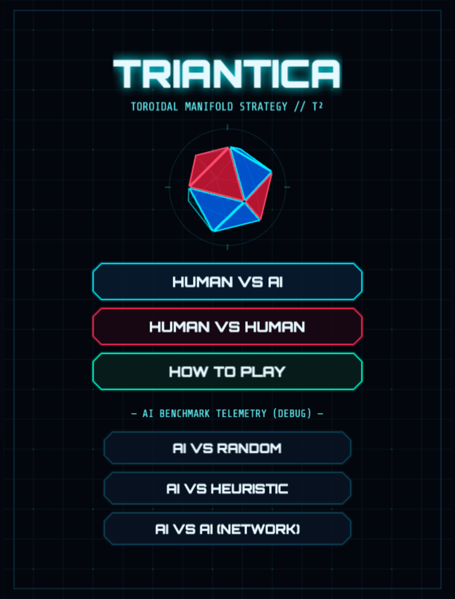
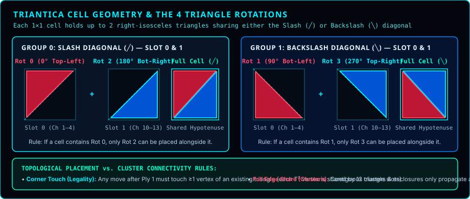
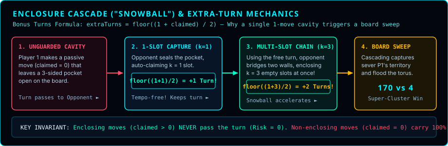
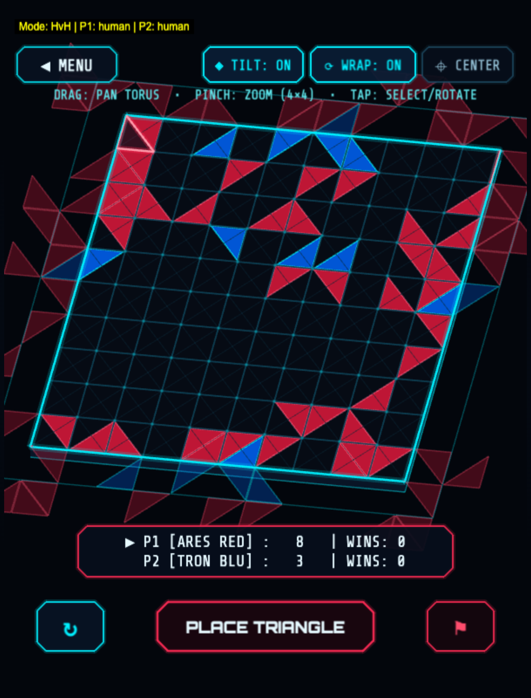

> **[📚 Training Book Index](./README.md)** | [← Book Index](./README.md) | [Chapter 2: RL Fundamentals →](./02-rl-fundamentals.md)

---

## 1. The Game: Why Triantica is Interesting for RL {#1-the-game}



### Game Rules in One Minute

Triantica is a two-player territorial strategy game played on a **$10 \times 10$ toroidal grid** where opposite edges wrap around seamlessly into a continuous doughnut-shaped surface ($T^2$ torus). Players (**Red = Player 1**, **Blue = Player 2**) take turns placing right-isosceles triangles into grid cells:

- **2 Triangles per Square (`╱` or `╲`):** Each square cell `(x, y)` can hold up to **2 triangles**, provided they share the same diagonal cut:
  - **Group 0 (`╱` slash diagonal):** Rotation `0` (Top-Left `◤`) and Rotation `2` (Bottom-Right `◢`).
  - **Group 1 (`╲` backslash diagonal):** Rotation `1` (Bottom-Left `◣`) and Rotation `3` (Top-Right `◥`).
- **Corner-Touch Placement Rule (`getValidMoves`):** After the opening move, every newly placed triangle must touch at least one vertex of an already-placed triangle anywhere in the 8-cell toroidal neighborhood.
- **Enclosure & Automatic Capture (`claimEnclosedTriangles`):** Whenever a placement seals off a pocket of $k \ge 1$ empty triangle slots so they can no longer reach the wider open board across unblocked edges, all $k$ enclosed slots are **automatically filled** with the active player's triangles.
- **Extra-Turn Snowball Mechanic:** Capturing an enclosure of $k$ triangles immediately awards bonus turns before the opponent can respond:
  $$\text{extraTurns} = \left\lfloor \frac{1 + k}{2} \right\rfloor$$
- **Victory Condition (Largest Contiguous Cluster):** When all 200 triangle slots on the $10 \times 10$ board are filled, each player's score is the size of their **single largest contiguous cluster** of triangles connected across shared edges (corner contact alone does not connect a cluster).

<details>
<summary>📐 Diagram: 10×10 toroidal grid (edges wrap around seamlessly) (click to expand ASCII)</summary>

```
┌──────────────────────────────────────────────────────────┐
│  • 10×10 toroidal grid (edges wrap around seamlessly)    │
│  • Players alternate placing right-isosceles triangles   │
│  • Up to 2 triangles per cell along a shared diagonal:   │
│      Group 0 (╱): Rot 0 (Top-Left) & Rot 2 (Bottom-Right)│
│      Group 1 (╲): Rot 1 (Bottom-Left) & Rot 3 (Top-Right)│
│  • Must touch an existing corner to be a legal placement │
│  • Enclose empty triangle slots to auto-claim them       │
│  • Capturing enclosures grants extra turns:              │
│      extraTurns += floor((1 + claimed) / 2)              │
│  • Largest contiguous cluster of triangles wins!         │
└──────────────────────────────────────────────────────────┘
```

</details>

#### Cell Geometry & The 4 Triangle Rotations

Every square cell `(x, y)` on the $10 \times 10$ board can hold up to **2 right-isosceles triangles**. Because two triangles in the same square cannot overlap, they must share the same diagonal cut (`╱` or `╲`). Crucially, **placement legality** only requires touching an existing vertex (corner), whereas **scoring connectivity** requires sharing a full triangle leg or hypotenuse across adjacent cells:



<details>
<summary>📖 ASCII Reference (original box-drawing diagram)</summary>

```
┌──────────────────────────────────────────────────────────────────────────────┐
│                TRIANTICA CELL GEOMETRY & DIAGONAL GROUPS                     │
├──────────────────────────────────────────────────────────────────────────────┤
│                                                                              │
│      GROUP 0: Slash Diagonal (╱)            GROUP 1: Backslash Diagonal (╲)  │
│                                                                              │
│     Rot 0 (0° Top-Left)   Rot 2 (180° Bot-Right)   Rot 1 (90° Bot-Left)   Rot 3 (270° Top-Right) │
│        ┌─────────┐           ┌─────────┐              ┌─────────┐            ┌─────────┐         │
│        │ ▲ ▲ ▲ ╱ │           │       ╱ │              │ ╲       │            │ ╲ ▲ ▲ ▲ │         │
│        │ ▲ ▲ ╱   │     +     │     ╱ ▲ │              │   ╲     │      +     │   ╲ ▲ ▲ │         │
│        │ ▲ ╱     │           │   ╱ ▲ ▲ │              │ ▲   ╲   │            │     ╲ ▲ │         │
│        │ ╱       │           │ ╱ ▲ ▲ ▲ │              │ ▲ ▲   ╲ │            │       ╲ │         │
│        └─────────┘           └─────────┘              └─────────┘            └─────────┘         │
│                                                                              │
│   • Rule 1 (No Overlap): If a cell already holds Rot 0, only Rot 2 fits.     │
│                          If a cell already holds Rot 1, only Rot 3 fits.     │
│   • Rule 2 (Corner Touch): Every move after Ply 1 must touch at least one    │
│                            vertex of an already-placed triangle (8-way       │
│                            neighborhood on the T² torus).                    │
│   • Rule 3 (Cluster Connectivity): Triangles belong to the same contiguous   │
│                            cluster ONLY if they belong to the same player    │
│                            AND share a full edge (horizontal, vertical, or   │
│                            internal diagonal—corner touch alone does not     │
│                            connect a cluster!).                              │
│                                                                              │
└──────────────────────────────────────────────────────────────────────────────┘
```

</details>

**Visual example of enclosure:**

<details>
<summary>📐 Diagram: Before move: After move (enclosure): (click to expand ASCII)</summary>

```
Before move:          After move (enclosure):
    ┌───┬───┬───┐         ┌───┬───┬───┐
    │ ▲ │   │ ▼ │         │ ▲ │███│ ▼ │
    ├───┼───┼───┤         ├───┼───┼───┤
    │ ◀ │ ? │ ▶ │    →    │ ◀ │▲▼▶│ ▶ │
    ├───┼───┼───┤         ├───┼───┼───┤
    │ ▼ │   │ ▲ │         │ ▼ │███│ ▲ │
    └───┴───┴───┘         └───┴───┴───┘
                        Center enclosed!
```

</details>

#### Why the Extra-Turn Snowball Mechanic Changes Everything

When a move encloses $k \ge 1$ empty triangle slots via flood-fill (`claimEnclosedTriangles`), two things happen simultaneously:
1. All $k$ enclosed slots are immediately filled with the active player's triangles (expanding their contiguous cluster).
2. The player earns **bonus turns** according to:
   $$\text{extraTurns} = \left\lfloor \frac{1 + k}{2} \right\rfloor$$



<details>
<summary>📖 ASCII Reference (original box-drawing diagram)</summary>

```
┌──────────────────────────────────────────────────────────────────────────────┐
│                 THE ENCLOSURE CASCADE ("SNOWBALL") DYNAMICS                  │
├──────────────────────────────────────────────────────────────────────────────┤
│                                                                              │
│   Blunder (Leaves 1 Hole) ──► Opponent Caps 1 Slot (k=1)                     │
│                                     │                                        │
│                                     ▼  extraTurns = floor((1+1)/2) = +1 Turn │
│                               Opponent Places Free Piece                     │
│                                     │                                        │
│                                     ▼  Creates New Enclosure (k=3 Slots!)    │
│                               extraTurns = floor((1+3)/2) = +2 Turns!        │
│                                     │                                        │
│                                     ▼                                        │
│                         Cascading Board Sweep (170 vs 4)                     │
│                                                                              │
└──────────────────────────────────────────────────────────────────────────────┘
```

</details>

**Strategic & RL Consequence (Second-Mover Counter-Attack Edge):**
- Even enclosing a **single triangle ($k = 1$)** yields $\lfloor 2/2 \rfloor = \mathbf{1\text{ extra turn}}$, making single-slot enclosures tempo-free ("free moves" that keep the initiative!).
- Enclosing **$k = 3$ triangles** yields **2 extra turns**, allowing a player to chain multi-step enclosure cascades before the opponent ever gets to move again.
- **P2 Counter-Attack Dynamics:** In early deterministic openings without random 2-ply seeding, Player 2 reacts directly to Player 1's opening placement, using the first defensive wall to trigger the initial enclosure cascade. Because winning is determined by the **largest single contiguous edge-sharing cluster** (out of 200 total triangles when the board fills), a single mid-game cascade can sever the opponent's cluster in two while merging the attacker's pieces into a 140+ triangle super-cluster.

**Key insight:** The game has **400 possible actions** per turn (100 cells × 4 rotations), but only ~50 are typically valid. The AI must learn:
1. Which moves are legal (corner-touch + diagonal compatibility)
2. Which moves create immediate enclosures and tempo-preserving bonus turns
3. Which moves build toward future enclosures while **never leaving an unguarded 1-move cavity** for the opponent to chain-cascade!

### The Game in Action



The 2.5D tilted viewport shows both players' triangles in their canonical colors (Red = P1, Blue = P2), with the wrap-around toroidal seam visible at the board edges.

### Why This Game Exposes Fundamental RL Challenges

Compared to classic board games like Chess or Go, Triantica combines a moderate branching factor with an unusually volatile, non-linear reward surface:

| Game | Typical Legal Moves | Positional Evaluation | Core RL Challenge |
| :--- | :--- | :--- | :--- |
| **Chess** | ~35 | Material balance + piece activity | Deep tactical lines, discrete material exchanges |
| **Go** | ~250 | Global territory & group life/death | Huge branching factor, subtle influence |
| **Triantica** | **~50** (out of 400 slots) | **Non-linear cascade potential** | **Delayed credit assignment + snowball traps** |

<details>
<summary>📐 Diagram: Game Complexity Comparison (click to expand ASCII)</summary>

```
┌─────────────────────────────────────────────────────────────┐
│                    Game Complexity Comparison                │
├─────────────────────────────────────────────────────────────┤
│                                                             │
│  Game        │ Legal Moves │ Evaluation      │ Difficulty  │
│  ────────────┼─────────────┼─────────────────┼────────────│
│  Chess       │ ~35         │ Piece values     │ Medium      │
│  Go          │ ~250        │ Territory count │ Hard        │
│  Triantica   │ ~50         │ Delayed signal  │ Hard        │
│                                                             │
│  The challenge: A move that looks good now might be       │
│  terrible in 20 turns because it blocked your own         │
│  future enclosure.                                          │
│                                                             │
└─────────────────────────────────────────────────────────────┘
```

</details>

**This is the core RL problem:** Credit assignment. How do you learn which move, 30 turns ago, caused your victory?

### State Representation: How the AI Sees the Board

A neural network cannot perceive pixels or geometric shapes directly; the core board state and rules engine (`src/core/GridManager.js`) must translate the board into a mathematical tensor.

In our earliest feedforward experiments (`brain.js` and `TF-B1` through `TF-B4`), we encoded the board as a **flat `401`-element vector** (`100` cells $\times$ `4` values per cell $+$ `1` bias unit). For each cell, two slots recorded the owner (`+1` for self, `-1` for opponent, `0` for empty) and normalized rotation (`0.0, 0.25, 0.5, 0.75`):

<details>
<summary>📐 Diagram: Input Vector (401 values) (click to expand ASCII)</summary>

```
┌─────────────────────────────────────────────────────────────┐
│                    Input Vector (401 values)                 │
├─────────────────────────────────────────────────────────────┤
│                                                             │
│  For each cell (100 cells × 4 values):                      │
│  ─────────────────────────────                              │
│  [0] Triangle 1 player: +1 if AI, -1 if opponent, 0 if empty│
│  [1] Triangle 1 rotation: 0.0, 0.25, 0.5, or 0.75           │
│  [2] Triangle 2 player: +1 if AI, -1 if opponent, 0 if empty│
│  [3] Triangle 2 rotation: 0.0, 0.25, 0.5, or 0.75           │
│                                                             │
│  Final element [400]: Always 1 (bias signal)               │
│                                                             │
│  Example cell with one AI triangle at 90°:                  │
│  [+1, 0.25, 0, -1, ...]  ← T1 is AI at 90°, T2 empty       │
│                                                             │
└─────────────────────────────────────────────────────────────┘
```

</details>

**Why this encoding?** This "fixed perspective" encoding means:
- AI always sees its own pieces as +1
- Opponent's pieces as -1
- The same board position looks the same regardless of which player the AI is assigned

This is critical for generalization (see Bug #1 in Section 7).

### How State Representation Evolved Across the Project

While our early feedforward experiments (`brain.js` and `TF-B1` through `TF-B4`) used this flat `401`-element vector, a 1D vector destroys 2D board geometry: cells `(x=4, y=4)` and `(x=4, y=5)` are adjacent on the board, yet sit `40` indices apart in the flattened array.

To unlock spatial pattern recognition and eventually break the Heuristic Wall, our state representation evolved through three distinct stages (explored in full mathematical detail in [Chapter 11A](./11a-replay-and-conv-encoding.md) and [Chapter 11E](./11e-quiescence-mcts-and-torus-mastery.md)):

1. **Stage 1 — Flat `401`-Element Vector (`brain.js` & `TF-B1`–`TF-B4`):** Encodes `100` cells $\times$ `4` scalar values $+$ `1` bias. Suffers from zero 2D spatial locality and an arbitrary creation-order slot-shuffling bug (where the same geometric cell state produced different vectors depending on which triangle was placed first).
2. **Stage 2 — Canonical `10×10×18` Ego-Centric Spatial Tensor (`TF-B5`–`TF-B14`):** Assigns deterministic geometric slots (`Slot 0` = rotations `{0, 1}`, `Slot 1` = rotations `{2, 3}`) with a 9-way one-hot encoding per slot (`18` channels per cell). This unlocked $3 \times 3$ convolutional cavity detection, though standard zero-padding still treated the edges of the $10 \times 10$ array as artificial walls.
3. **Stage 3 — Full $T^2$ Toroidal Manifold + Circular Padding (`TF-B15` Champion):** Wraps the `[10, 10, C]` feature map into `[12, 12, C]` by copying opposite borders (`ToroidalPad2D`) before every $3 \times 3$ convolution layer, achieving exact translation equivariance across all 100 cells with zero border seams.

<details>
<summary>📐 Diagram: EVOLUTION OF TRIANTICA BOARD STATE REPRESENTATION (click to expand ASCII)</summary>

```
┌──────────────────────────────────────────────────────────────────────────────┐
│            EVOLUTION OF TRIANTICA BOARD STATE REPRESENTATION                 │
├──────────────────────────────────────────────────────────────────────────────┤
│                                                                              │
│  Stage 1: Flat 401-Element Vector (brain.js & TF-B1..B4)                     │
│  • Shape: [401] (100 cells × 4 scalar values + 1 bias)                       │
│  • Flaw:  Arbitrary creation-order slot shuffling (Bug 3) + no 2D locality   │
│                                                                              │
│  Stage 2: Canonical 10×10×18 Spatial Tensor (TF-B5..TF-B14)                  │
│  • Shape: [10, 10, 18] (Slot 0 = rots {0,1}; Slot 1 = rots {2,3}; 9-way 1-hot│
│  • Gain:  Strict rotation invariance + 3×3 Conv2D enclosure detection,       │
│           but zero-padded borders blurred toroidal wrap-around edges         │
│                                                                              │
│  Stage 3: Full T² Toroidal Manifold + ToroidalPad2D (TF-B15 Champion)        │
│  • Shape: [10, 10, 18] wrapped to [12, 12, C] before every 3×3 Conv2D layer  │
│  • Gain:  True translation equivariance across all 100 cells (no edge seams) │
│                                                                              │
└──────────────────────────────────────────────────────────────────────────────┘
```

</details>


---

> [← Book Index](./README.md) | **[📚 Training Book Index](./README.md)** | [Chapter 2: RL Fundamentals →](./02-rl-fundamentals.md)
