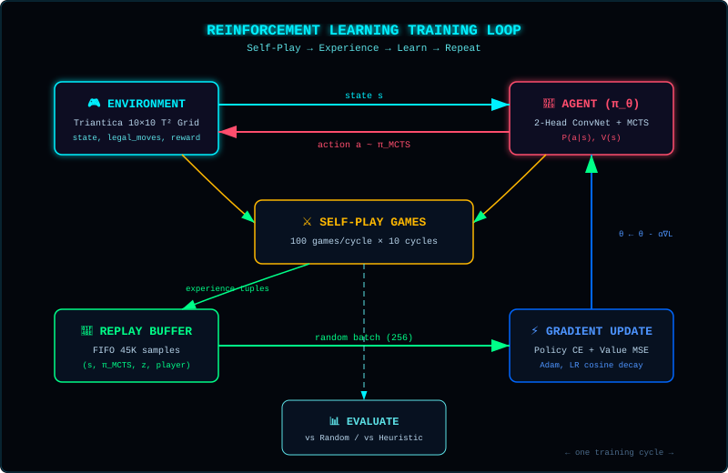

> **[📚 Training Book Index](./README.md)** | [← Chapter 1: The Game](./01-the-game.md) | [Chapter 3: The Architecture Journey →](./03-architecture-journey.md)

---

## 2. RL Fundamentals Through This Project {#2-rl-fundamentals}

### The RL Loop Explained

Reinforcement learning is different from supervised learning. There's no labeled dataset — the agent learns by interacting with the environment.



<details>
<summary>📖 ASCII Reference (original diagram)</summary>

```
┌─────────────────────────────────────────────────────────────┐
│                    The RL Training Loop                      │
├─────────────────────────────────────────────────────────────┤
│                                                             │
│   ┌─────────────┐                      ┌─────────────┐      │
│   │             │   1. Choose action   │             │      │
│   │    Agent    │ ───────────────────► │    Game     │      │
│   │  (Neural    │      (move)         │ (State)     │      │
│   │   Network)  │                     │             │      │
│   │             │ ◄─────────────────── │             │      │
│   └─────────────┘   2. Observe result  └─────────────┘      │
│         │                                                    │
│         │  3. New state + reward                             │
│         │                                                    │
│         ▼                                                    │
│   ┌─────────────┐                                            │
│   │   Update    │   4. Learn from experience                │
│   │   policy    │      (adjust neural network)               │
│   └─────────────┘                                            │
│                                                             │
└─────────────────────────────────────────────────────────────┘
```

</details>

**In Triantica:**
- **Agent**: Neural network that outputs move probabilities
- **Environment**: The game board + rules
- **State**: 401-number vector representing the board
- **Action**: Which triangle to place where (400 options)
- **Reward**: Points scored + bonus for winning

### What is a Policy?

A **policy** (denoted π) is the agent's strategy — it maps states to actions.

<details>
<summary>📐 Diagram: Policy Network (click to expand ASCII)</summary>

```
┌─────────────────────────────────────────────────────────────┐
│                    Policy Network                            │
├─────────────────────────────────────────────────────────────┤
│                                                             │
│  Input Layer         Hidden Layer         Output Layer      │
│  (401 neurons)       (200 neurons)        (400 neurons)     │
│                                                             │
│     ○ ○ ○ ○              ○ ○ ○               ○ ○ ○ ○        │
│     ○ ○ ○ ○    ╲╱╲╱      ○ ○ ○     ╲╱╲╱     ○ ○ ○ ○        │
│     ○ ○ ○ ○    ╱╲╱╲      ○ ○ ○     ╱╲╱╲     ○ ○ ○ ○        │
│     ○ ○ ○ ○              ○ ○ ○               ○ ○ ○ ○        │
│       ...                ...                 ...            │
│                                                             │
│  Board state    Learned patterns      Move probabilities   │
│  (401 values)   (intermediate)        (higher = better)    │
│                                                             │
└─────────────────────────────────────────────────────────────┘

Mathematical form: π(a|s) = P(taking action a | in state s)
```

</details>

**Key insight:** The policy network doesn't output a single "best move". It outputs a probability distribution over all possible moves. This allows:
1. **Exploration**: Sometimes picking lower-probability moves to discover new strategies
2. **Training**: We can reinforce good moves (increase their probability) and discourage bad ones

### Policy Gradient: How We Train

The simplest RL algorithm is **policy gradient**. Here's how it works:

<details>
<summary>📐 Diagram: Policy Gradient Training (click to expand ASCII)</summary>

```
┌─────────────────────────────────────────────────────────────┐
│                Policy Gradient Training                     │
├─────────────────────────────────────────────────────────────┤
│                                                             │
│  Step 1: Play games                                         │
│  ──────────────────                                         │
│  - Agent plays against itself (self-play)                  │
│  - Record: state, action chosen, reward received           │
│                                                             │
│  Step 2: Label moves                                        │
│  ──────────────────                                         │
│  - If game won: label all moves as "good" (target = +1)    │
│  - If game lost: label all moves as "bad" (target = -1)   │
│  - Adjust by temporal position (early moves less credit)   │
│                                                             │
│  Step 3: Train network                                       │
│  ──────────────────                                         │
│  - Input: state                                             │
│  - Target output: probability of chosen move = reward      │
│  - Minimize difference between predicted and target        │
│                                                             │
│  Effect: Network learns to increase probability of         │
│         moves that led to winning games                     │
│                                                             │
└─────────────────────────────────────────────────────────────┘
```

</details>

**Mathematical intuition:**

```
Loss = -log(π(action | state)) × reward

If reward is positive (won): minimize -log(π) → increase π
If reward is negative (lost): minimize -log(π) → decrease π
```

### Three Approaches to RL

<details>
<summary>📐 Diagram: THE 3 RL PARADIGMS BUILT IN TRIANTICA (click to expand ASCII)</summary>

```
┌──────────────────────────────────────────────────────────────────────────────┐
│                  THE 3 RL PARADIGMS BUILT IN TRIANTICA                       │
├──────────────────────────────────────────────────────────────────────────────┤
│                                                                              │
│  1. Pure Policy Gradient (Phase 1 & 2: brain.js exp1–22, TF-B1–B4)           │
│     ──────────────────────────────────────────────────────────────           │
│     • Play games, label winning moves as "good", losing moves as "bad"       │
│     • Simple, fast, no lookahead; high variance (noisy gradients)            │
│     • Result: 91% vs Random (exp20), 0% vs Heuristic ("The Heuristic Wall") │
│                                                                              │
│  2. 2-Head Convolutional Actor-Critic (Phase 3: TF-B5–TF-B6)                 │
│     ────────────────────────────────────────────────────────                 │
│     • Shared 3×3 Conv2D backbone + Two Heads: Actor (π) & Critic (V)         │
│     • Critic V(s) ∈ [-1, +1]: "Who is winning from this position?"          │
│     • Actor π(a|s): "Which legal move has the highest probability?"          │
│     • Result: Spatial feature detection unlocked; ready for tree search      │
│                                                                              │
│  3. AlphaZero + Quiescence MCTS on T² Torus (Phase 4 & 5: TF-B8–TF-B15)      │
│     ────────────────────────────────────────────────────────────────────     │
│     • Neural network guides Monte Carlo Tree Search (50 sims/move)           │
│     • Quiescence Extension resolves forced enclosure cascades at leaves      │
│     • ToroidalPad2D wraps the 10×10 board seamlessly across all 4 borders    │
│     • Result: 100% vs Random, 99.0% Raw / 100.0% +Safety vs Heuristic!       │
│                                                                              │
└──────────────────────────────────────────────────────────────────────────────┘
```

</details>

Our initial feedforward network (`brain.js` and `TF-B1`–`TF-B4`) used pure **policy gradient** — the simplest approach. It worked for beating random players (`91%`), but scored `0%` against strategic opponents (`HeuristicPlayer`), hitting what we called the **"Heuristic Wall"** (see [Chapter 8](./08-the-heuristic-wall.md)). Over the course of the project, we systematically built all three paradigms: transitioning to a **2-Head Convolutional Actor-Critic** (`TF-B5`–`TF-B6`), integrating **AlphaZero-style MCTS** (`TF-B8`–`TF-B10`), and ultimately inventing **Quiescence MCTS + Toroidal Manifold Convolutions** (`TF-B12`–`TF-B15`) to reach **`99%` raw / `100%` +Safety** against the Heuristic master.

### Why Credit Assignment Fails in Triantica Without a Value Critic & Search

Why did pure Policy Gradient hit an impenetrable `0%` ceiling against a tactical opponent, even after 45 training cycles? Because of **delayed catastrophic punishment**:

<details>
<summary>📐 Diagram: THE CREDIT ASSIGNMENT PROBLEM IN SNOWBALL GAMES (click to expand ASCII)</summary>

```
┌──────────────────────────────────────────────────────────────────────────────┐
│            THE CREDIT ASSIGNMENT PROBLEM IN SNOWBALL GAMES                   │
├──────────────────────────────────────────────────────────────────────────────┤
│                                                                              │
│  Ply 1..38: AI plays 19 solid territorial moves (building a 30-piece cluster)│
│  Ply 40:    AI makes ONE careless move that leaves a 1-move cavity           │
│  Ply 41:    Heuristic opponent caps the cavity → triggers a 12-turn cascade! │
│  Ply 170:   Game ends. Score: AI = 14, Heuristic = 166. Outcome z = -1.      │
│                                                                              │
│  What Pure Policy Gradient (Stage 1) Does:                                   │
│  ─────────────────────────────────────────                                   │
│  • Assigns a negative target (z = -1) to ALL 20 moves the AI played!         │
│  • The 19 good moves at Plies 1..38 are punished alongside the 1 blunder     │
│    at Ply 40. The network unlearns its good opening and midgame patterns!    │
│                                                                              │
│  What Actor-Critic + Quiescence MCTS (Stages 2 & 3) Does:                    │
│  ────────────────────────────────────────────────────────                    │
│  • At Ply 40, MCTS simulates the candidate move, triggers the Quiescence     │
│    cascade rollout immediately at the leaf, and the Value Head sees V = -0.9 │
│  • MCTS shifts visit counts AWAY from the blunder before the move is played  │
│  • Every state s_t is localized: good positions keep high value V(s_t) > 0,  │
│    while only the specific blunder branch is penalized!                      │
│                                                                              │
└──────────────────────────────────────────────────────────────────────────────┘
```

</details>

### Exploration vs Exploitation

<details>
<summary>📐 Diagram: Exploration vs Exploitation (click to expand ASCII)</summary>

```
┌─────────────────────────────────────────────────────────────┐
│               Exploration vs Exploitation                   │
├─────────────────────────────────────────────────────────────┤
│                                                             │
│  Exploration (ε = 0.3):                                     │
│  ────────────────────                                       │
│  • Try random moves 30% of the time                         │
│  • Discover new strategies                                  │
│  • Risk: Wastes time on bad moves                           │
│                                                             │
│  Exploitation (ε = 0.0):                                    │
│  ─────────────────────                                       │
│  • Always pick highest probability move                     │
│  • Use current knowledge                                     │
│  • Risk: Misses better strategies                           │
│                                                             │
│  Balance:                                                   │
│  ─────────                                                   │
│  • High exploration early (ε = 0.5)                         │
│  • Reduce over time (ε → 0.1)                               │
│  • Zero for evaluation                                      │
│                                                             │
└─────────────────────────────────────────────────────────────┘
```

</details>

In our project, how we balanced exploration and exploitation evolved alongside the architecture:
1. **Stage 1 (Feedforward Policy Gradient):** Used **$\varepsilon$-greedy exploration** (`explorationRate = 0.1` to `0.3`) plus a `50%` random opening override on the first 3 plies to prevent deterministic self-play loops.
2. **Stage 2 & 3 (AlphaZero / Quiescence MCTS):** Replaced naive random moves with **Dirichlet root noise** ($\text{Dir}(\alpha=0.3)$, $\varepsilon=0.25$) blended into the root prior $P(s,a)$, combined with **PUCT uncertainty bonuses** ($c_{\text{puct}} \cdot P(s,a) \frac{\sqrt{N(s)}}{1 + N(s,a)}$) and temperature-controlled visit sampling ($\tau = 1.0$ for moves $1\dots 15$, $\tau = 0.1$ thereafter). This ensures the agent explores *plausible tactical alternatives* rather than throwing away games with random blunders.

### Telemetry & Metrics: How We Read the AI's Mind During Training

When training a reinforcement learning agent over hours of self-play, watching a single "Win Rate" number is like flying an airplane with only an altimeter. When the win rate stalls at `0%` or suddenly crashes from `54%` to `15%`, you need diagnostic instruments that separate **exploration health**, **optimization health**, **role symmetry**, and **true strategic dominance**.

Throughout this guide, every experiment is tracked through six core telemetry signals on the Triantica Training Dashboard:

<details>
<summary>📐 Diagram: THE 6 CORE TELEMETRY SIGNALS & WHAT THEY DIAGNOSE (click to expand ASCII)</summary>

```
┌──────────────────────────────────────────────────────────────────────────────┐
│             THE 6 CORE TELEMETRY SIGNALS & WHAT THEY DIAGNOSE                │
├──────────────────────────────────────────────────────────────────────────────┤
│                                                                              │
│  1. Win Rate Split by Role (P1 First-Mover vs P2 Second-Mover)               │
│     • Why we track it: Triantica has a massive P2 counter-attack advantage   │
│       in deterministic openings. Overall win rate hides role-blindness!      │
│     • Healthy signature: Balanced competence in both seats (e.g., TF-B15     │
│       achieves 100% as P1 and 98% raw / 100% +Safety as P2).                 │
│     • Pathological signature: 50% overall win rate caused by 100% P2 wins    │
│       and 0% P1 wins—or a flat 50.0% caused by the Role-Swap Bug (Bug #11).  │
│                                                                              │
│  2. Score Distribution (Largest Contiguous Cluster: AI vs Opponent)          │
│     • Why we track it: Win rate is binary (0 or 1); cluster scores (out of   │
│       200 total triangles) measure territorial margin BEFORE the first win.  │
│     • Healthy signature: Against Heuristic, losing 4 to 170 means total      │
│       cascade wipeout; climbing to 65 vs 95 signals the AI is surviving      │
│       mid-game cascades even if win rate is still 0%; 138 vs 32 (TF-B15)     │
│       proves total territorial dominance.                                    │
│                                                                              │
│  3. Opening Diversity (Shannon Entropy of First Moves, in bits)              │
│     • Formula: H_open = - Σ p(m_1) log_2 p(m_1)  (Max = log_2(100) ≈ 6.64 b) │
│     • Why we track it: Detects policy mode collapse early in the game.       │
│     • Healthy signature: 5.0 – 6.2 bits during MCTS self-play (exploring     │
│       40–75 distinct openings per 100-game cycle).                           │
│     • Pathological signature: Dropping below 2.5 bits means the network      │
│       is memorizing a single deterministic opening line.                     │
│                                                                              │
│  4. Board Diversity (Shannon Entropy of Final End-Game Boards, in bits)      │
│     • Why we track it: Even if openings vary, do games converge into the     │
│       same repetitive end-game structures?                                   │
│     • Healthy signature: ~1.95 – 1.98 bits across 100 games, confirming      │
│       rich structural variety in completed 200-triangle boards.              │
│                                                                              │
│  5. Cycle Error Curve: Initial Error (e_start) vs Final Error (e_end)        │
│     • Why we track it: Measures how surprised the network is by new          │
│       self-play data (e_start) and how well gradient descent fits it (e_end).│
│     • Healthy signature: A clear "sawtooth" drop every cycle                 │
│       (e.g., e_start = 1.91 ──► e_end = 1.38 in ConvNet Actor-Critic),       │
│       with both baseline and final loss trending downward across cycles.     │
│     • Pathological signatures:                                               │
│       - Crash-to-zero (e_end → 0.000000): Catastrophic overfitting to a tiny │
│         current-cycle buffer without replay memory.                          │
│       - Micro-drop plateau (1.312 ──► 1.299): Gradient cancellation (dual-   │
│         perspective bug) or 400× MSE policy loss dilution (Bug #10).         │
│                                                                              │
│  6. Raw 1-Ply Policy Eval vs +Safety Filter Eval                             │
│     • Why we track it: Separates pure neural intuition (single forward pass  │
│       argmax(π) in ~0.8 ms) from tactical blunder-checking.                  │
│     • Healthy signature: Raw network reaches 99.0% vs Heuristic on intuition │
│       alone; the 1-ply safety filter closes the final 1% edge case to 100%.  │
│                                                                              │
└──────────────────────────────────────────────────────────────────────────────┘
```

</details>

---

---

> [← Chapter 1: The Game](./01-the-game.md) | **[📚 Training Book Index](./README.md)** | [Chapter 3: The Architecture Journey →](./03-architecture-journey.md)
