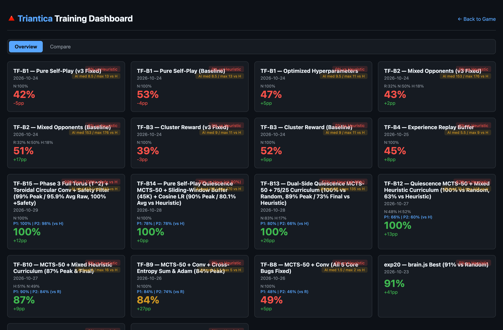
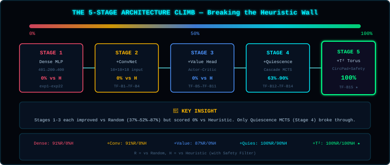

> **[📚 Training Book Index](./README.md)** | [← Chapter 7: Critical Bugs & Forensic Audits](./07-critical-bugs-and-audits.md) | [Chapter 9: Experiment Reference →](./09-experiment-reference.md)

---

## 8. The Heuristic Wall: Understanding Architectural Limits & How We Broke It {#8-heuristic-wall}

### The Experiment That Changed Everything



After 22 `brain.js` experiments and 10+ early `TensorFlow.js` experiments, a stark empirical pattern emerged—while our networks reliably beat `RandomPlayer` (`27%–91%`), every single experiment scored **`0.0%` (`0` wins across `3,000+` evaluation games)** against the deterministic rule-based opponent (`src/ai/HeuristicPlayer.js`):

<details>
<summary>📐 Diagram: Performance Summary (click to expand ASCII)</summary>

```
┌─────────────────────────────────────────────────────────────┐
│                   Performance Summary                        │
├─────────────────────────────────────────────────────────────┤
│                                                             │
│   Opponent      │  Best Win Rate  │  All Experiments         │
│   ──────────────┼─────────────────┼────────────────────────  │
│   Random        │     91%        │      27-91%              │
│   Heuristic     │      0%        │       0%                 │
│                                                             │
│   Conclusion: The architecture cannot beat strategic play   │
│                                                             │
└─────────────────────────────────────────────────────────────┘
```

</details>

### Why Can't a Feedforward Network Beat Heuristic?

To understand why the Heuristic Wall was so formidable, compare how the deterministic heuristic opponent (`src/ai/HeuristicPlayer.js`) evaluates the board against what a 1-ply feedforward network (`src/ai/NeuralNetwork.js`) computes:

- **The Deterministic Heuristic Opponent (`HeuristicPlayer.js`):** On every turn, it clones the board and explicitly simulates every legal move, assigning `+100 points` per enclosed triangle, `-80 points` for any move that leaves an immediate counter-enclosure for the opponent, and `+10 points` per contiguous cluster connection. It is a **2-ply tactical lookahead engine** that never misses an immediate capture and never walks into a 1-move cavity trap.
- **The 1-Ply Feedforward Network:** Flattens the $10 \times 10$ board into `401` unstructured scalars, multiplies by a single dense matrix (`[401 × 200]`), and outputs `400` move probabilities in one pass—with **no spatial translation invariance, no state-value critic, and zero lookahead search**.

<details>
<summary>📐 Diagram: Heuristic Strategy (click to expand ASCII)</summary>

```
┌─────────────────────────────────────────────────────────────┐
│                    Heuristic Strategy                        │
├─────────────────────────────────────────────────────────────┤
│                                                             │
│   For each legal move:                                      │
│   1. Simulate placement on a cloned grid                    │
│   2. Count immediate enclosures (+100 pts per triangle!)    │
│   3. Penalize opponent counter-enclosures (-80 pts each!)   │
│   4. Score cluster connections (+10 pts per triangle)       │
│   5. Add center bias + small tie-breaking jitter            │
│                                                             │
│   Result: Deterministic 2-ply tactical lookahead that       │
│   NEVER misses an enclosure and NEVER leaves a 1-move hole. │
│                                                             │
└─────────────────────────────────────────────────────────────┘

┌─────────────────────────────────────────────────────────────┐
│                   Feedforward Network                        │
├─────────────────────────────────────────────────────────────┤
│                                                             │
│   1. Flatten 10×10×4 board into 401 unstructured numbers    │
│   2. Multiply by a single dense matrix [401 × 200]          │
│   3. Output probability for each move [200 × 400]           │
│                                                             │
│   No spatial locality. No position critic. No lookahead.    │
│                                                             │
└─────────────────────────────────────────────────────────────┘
```

</details>

#### Two Architectural Blind Spots: Why Even Vanilla AlphaZero MCTS Scored `0%`

When we first diagnosed the Heuristic Wall after `exp22` and `TF-B4`, our initial hypothesis was simple: *"Add a Convolutional Actor-Critic (`TF-B5`) and standard AlphaZero MCTS (`TF-B8`–`TF-B10`), and the wall will fall."*

**We were wrong.** Even after building the `10×10×18` ConvNet and fixing every gradient bug in standard MCTS-50 (`TF-B9` and `TF-B10`), our win rate against `Random` climbed to **`87.0%`**, yet our win rate against `HeuristicPlayer` remained **locked at `0.0%`!**

Why did both a `2-Head ConvNet` (`TF-B5`) AND `Vanilla AlphaZero MCTS-50` (`TF-B10`) score `0%` against `Heuristic`? Because of two distinct domain mechanics in Triantica:

1. **Blind Spot #1 — Spatial Translation & Toroidal Border Blindness:**
   - In a flat `401`-element vector (`Stage 1`), shifting a 3-sided cavity by one cell to the right maps to completely different input neuron indices; without spatial weight sharing, a dense network must re-learn the same cavity shape 100 separate times across all 100 cells.
   - In a standard zero-padded $3\times 3$ ConvNet (`Stages 2–4`, `padding='same'`), the convolutional kernel shares weights across the interior $8\times 8$ cells, but fills the 1-cell border around the $10\times 10$ array with **zeros**. To the network, the board edges look like an impenetrable brick wall, blinding it to enclosures that wrap across the toroidal seam (`x=9 ↔ x=0`, `y=9 ↔ y=0`).
2. **Blind Spot #2 — The MCTS Horizon Effect on Forced Enclosure Cascades:**
   - Suppose the AI considers a non-enclosing move at the root of a vanilla 50-simulation MCTS search (`TF-B8`–`TF-B10`) that accidentally leaves a 1-move cavity. When MCTS expands that move as a new leaf node $s_{\text{leaf}}$ and queries the Value Head $V(s_{\text{leaf}})$, **the opponent's cascade has not happened yet!** The board still looks balanced in piece count, so $V(s_{\text{leaf}})$ returns a mildly positive score (`~+0.10`).
   - Then, in the real game, `HeuristicPlayer` steps up, spots the 1-move cavity with 100% determinism, chains 4 bonus turns in a row, and sweeps the board before the AI ever gets another turn. Solving this required **Quiescence MCTS** (`src/server/QuiescenceMCTS.cjs`), which rolls out forced greedy opponent cascades at leaf nodes *before* querying the Value Head.

<details>
<summary>📐 Diagram: BLIND SPOT #1: SPATIAL TRANSLATION BLINDNESS (FLAT vs CONV vs TORUS) (click to expand ASCII)</summary>

```
┌──────────────────────────────────────────────────────────────────────────────┐
│     BLIND SPOT #1: SPATIAL TRANSLATION BLINDNESS (FLAT vs CONV vs TORUS)     │
├──────────────────────────────────────────────────────────────────────────────┤
│                                                                              │
│  Consider a 3-sided "almost enclosed" cavity around cell (x, y):             │
│                                                                              │
│  • In a Flat 401-Vector (Stage 1: brain.js / TF-B1–B4):                      │
│    Shifting that cavity 1 cell to the right changes the active input indices │
│    from [140, 141, 180] to [144, 145, 184]. Because Dense layers have no     │
│    weight sharing across space, the network must re-learn the exact same     │
│    cavity geometry 100 separate times across all 100 cells!                  │
│                                                                              │
│  • In a Zero-Padded 3×3 Conv2D (Stage 2–4: TF-B5–TF-B14):                    │
│    A 3×3 convolutional kernel shares weights across the interior 8×8 cells,  │
│    recognizing cavities anywhere in the center. HOWEVER, `padding='same'`    │
│    fills the 1-cell border around the 10×10 grid with ZEROS. To the ConvNet, │
│    the board edge looks like an impenetrable brick wall, blinding it to      │
│    enclosures that wrap across the torus seam (x=9 ↔ x=0, y=9 ↔ y=0)!       │
│                                                                              │
└──────────────────────────────────────────────────────────────────────────────┘

┌──────────────────────────────────────────────────────────────────────────────┐
│     BLIND SPOT #2: THE MCTS HORIZON EFFECT ON FORCED ENCLOSURE CASCADES      │
├──────────────────────────────────────────────────────────────────────────────┤
│                                                                              │
│  Suppose the AI considers Move A at the root of an MCTS-50 search:           │
│  Move A is a non-enclosing move that accidentally leaves a 1-move cavity.    │
│                                                                              │
│  What happens in Vanilla MCTS-50 (TF-B8, TF-B9, TF-B10)?                     │
│  ───────────────────────────────────────────────────────                     │
│  1. MCTS expands Move A as a new leaf node s_leaf and queries Value Head V.  │
│  2. At s_leaf, the cascade HAS NOT HAPPENED YET! The board still looks       │
│     balanced in piece count, so the Value Head returns V(s_leaf) ≈ +0.10.    │
│  3. Even on subsequent simulations below Move A, the priors P(s,a) come      │
│     from an untrained/early policy network that explores 50 legal replies    │
│     semi-uniformly—missing the 5-step forced cascade sequence!               │
│  4. Then in the actual game, HeuristicPlayer steps up, spots the cavity      │
│     with 100% determinism, chains 4 extra turns in a row, and wipes out      │
│     the board before the AI ever gets another turn!                          │
│                                                                              │
│  How Quiescence MCTS (TF-B12–TF-B15) Solves the Horizon Effect:              │
│  ──────────────────────────────────────────────────────────────              │
│  • Whenever an MCTS leaf expansion lands on a non-enclosing move that        │
│    passes the turn while leaving opponent enclosures on the board,           │
│    QuiescenceMCTS immediately plays out the opponent's greedy enclosure      │
│    cascade (up to depth 5) BEFORE calling the Value Head V(s_quiet), AND     │
│    subtracts an explicit cascade risk penalty (-0.20 × cascaded claims).     │
│  • Result: Blunder leaves immediately evaluate to V ≈ -0.95 on Visit #1!     │
│                                                                              │
└──────────────────────────────────────────────────────────────────────────────┘
```

</details>

### The 5-Stage Architectural Climb That Broke the Wall (`0% → 63% → 90% → 100%`)

To turn this diagnosis into a complete engineering solution, we progressed through five distinct architectural stages—each solving the exact bottleneck exposed by the stage before it (see [Chapter 11](./11-deep-dive-convolutions-mcts.md) for full mathematical derivations and tensor traces):



<details>
<summary>📖 ASCII Reference (full stage-by-stage details)</summary>

```
┌──────────────────────────────────────────────────────────────────────────────┐
│     STAGE-BY-STAGE BREAKTHROUGH PROGRESSION (vs Random & vs Heuristic)       │
├──────────────────────────────────────────────────────────────────────────────┤
│                                                                              │
│  Stage 1: Feedforward Policy Gradient (exp1–exp22, TF-B1–TF-B4)              │
│  • Architecture: 401 → [200] → 400 Dense MLP + TD(λ) shaped rewards          │
│  • Telemetry:    91% vs Random (exp20), 0.0% vs Heuristic (Score: 4 vs 170)  │
│  • Bottleneck:   No spatial weight sharing, no value critic, no lookahead.   │
│                                                                              │
│  Stage 2: 2-Head Spatial ConvNet Actor-Critic (TF-B5 & TF-B6)                │
│  • Architecture: 10×10×18 Canonical Tensor → 3× Conv2D(64) → Policy + Value  │
│  • Telemetry:    50% vs Random, 0.0% vs Heuristic (Loss sawtooth: 1.91→1.38) │
│  • Bottleneck:   1-ply pattern recognition cannot foresee multi-turn traps.  │
│                                                                              │
│  Stage 3: Consolidated AlphaZero MCTS-50 (TF-B8, TF-B9, TF-B10)              │
│  • Architecture: Batched PUCT MCTS-50 + Masked Softmax CE Sum + Adam (1e-3)  │
│  • Telemetry:    87.0% vs Random (P1: 84%, P2: 90%), 0.0% vs Heuristic       │
│  • Bottleneck:   MCTS Horizon Effect—leaves are evaluated before forced      │
│                  enclosure cascades resolve, blinding V(s) to 1-move holes.  │
│                                                                              │
│  Stage 4: Quiescence MCTS + Sliding-Window Pure Self-Play (TF-B12–TF-B14)    │
│  • Architecture: Greedy cascade rollouts at MCTS leaves + Root Prior Shaping │
│                  + Dual-Side Teacher + 45K Sliding Replay + Cosine LR Decay  │
│  • Telemetry:    100.0% vs Random | vs Heuristic: 63% (B12) → 89% (B13)      │
│                  → 90.0% Peak / 80.1% Avg (B14) (Score: 106 vs 64!)          │
│  • Bottleneck:   Zero-padded Conv2D (`padding='same'`) is blind to cavities  │
│                  wrapping across the 10×10 torus borders (the ~20% gap).     │
│                                                                              │
│  Stage 5: Full T² Toroidal Manifold + Tactical Safety Filter (TF-B15)        │
│  • Architecture: Circular `ToroidalPad2D` on all 4 Conv layers + Full T²     │
│                  modulo corner symmetry + O(1) Top-K 1-Ply Safety Filter     │
│  • Telemetry:    100.0% vs Random | vs Heuristic: 99.0% Peak / 95.9% Avg Raw │
│                  1-Ply Policy, and 100.0% (1,000W / 0L / 0D) with +Safety!   │
│                  (Cluster Score: AI = 138.4 vs Heuristic = 31.8!)            │
│                                                                              │
└──────────────────────────────────────────────────────────────────────────────┘
```

</details>

---

> [← Chapter 7: Critical Bugs & Forensic Audits](./07-critical-bugs-and-audits.md) | **[📚 Training Book Index](./README.md)** | [Chapter 9: Experiment Reference →](./09-experiment-reference.md)
