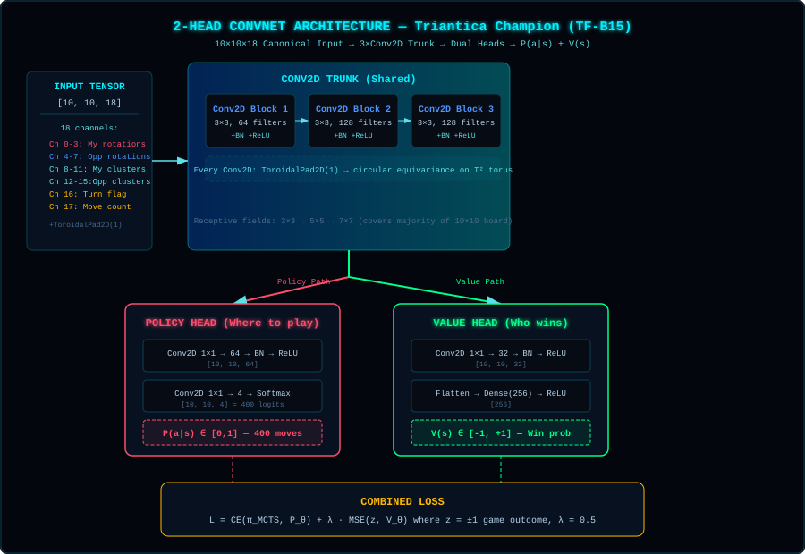

> **[📚 Training Book Index](./README.md)** | **[Ch 11 Index](./11-deep-dive-convolutions-mcts.md)** | [← Chapter 10: Key Takeaways](./10-key-takeaways.md) | [11B: Milestone Runs (TF-B5 to TF-B13) →](./11b-milestone-runs-tf-b5-to-b13.md)

---

## 11. Deep Dive: Convolutions, Dual Heads, MCTS & Pipeline Consolidation {#11-optimization-roadmap}

This chapter walks through the step-by-step architectural roadmap that took Triantica from the feedforward baseline (`37–52%` vs Random, `0%` vs Heuristic) to **100.0% Full Torus ($T^2$) mastery (`TF-B15`)**. Each phase builds on the previous one, detailing the underlying reinforcement learning theory, exact tensor transformations, and hardware-level design decisions for TensorFlow.js on the Mac Studio M2 Ultra.

### Initial Pre-ConvNet Baseline vs. Final Achieved State

| Metric | Initial Dense Baseline (`TF-B1`–`B3`) | Original Roadmap Target | **Final Achieved (`TF-B15` Champion)** |
|--------|--------------------------------------|-------------------------|----------------------------------------|
| vs Random | 37–52% | 80%+ | **100.0% (`1,000W / 0L / 0D` across all 10 cycles)** |
| vs Heuristic | 0% | 10%+ | **99.0% Peak (`95.9%` Avg) Raw 1-Ply / 100.0% (`1,000W / 0L`) +Safety** |
| Training time (10 cycles) | ~40 min (Dense) | Fast M2 Ultra batching | **~140 ms / 50-sim MCTS move (Dual-State GPU Batching)** |
| Replay Buffer Strategy | None (1-cycle memory) | Circular Replay Buffer | **45,000-sample FIFO Sliding Window (`~3.5` cycles of Dual-Side MCTS)** |

**Why these milestones mattered:** Breaking 10% vs Heuristic (`TF-B12` hit `63%`) proved the architecture could learn multi-turn tactical concepts; reaching `99.0%` raw 1-ply / `100.0%` with the tactical safety filter (`TF-B15`) proved that combining canonical spatial representations, quiescence tree search, and exact $T^2$ toroidal convolution equivariance solves the Heuristic Wall completely.

---

### Phase 1: Experience Replay Buffer

**Architectural Motivation:**
In our earliest TensorFlow.js baseline (`TF-B1`), the training loop played 20–100 self-play games, ran gradient descent on those trajectories, and immediately discarded them before starting the next cycle. Because the neural network only ever saw the most recent cycle's board states, it suffered from **catastrophic forgetting**: optimizing weights for Cycle $k$ overwrote the decision boundaries learned in Cycles $1 \dots k-1$, causing the within-cycle training error to collapse to `0.0000` while evaluation win rates oscillated wildly.

**How Experience Replay Solves Catastrophic Forgetting:**
To stabilize non-stationary self-play, we introduced the **Experience Replay Buffer** (`src/server/ReplayBuffer.cjs`)—a circular First-In-First-Out (FIFO) memory store that retains historical `(state, targetPolicy, chosenIndex, valueTarget)` tuples across cycles. During backpropagation at the end of each cycle, the training pipeline (`src/server/train_tfjs.cjs`) mixes **100% of the newly generated self-play states** with a **`2.0×` random sample of historical states** drawn uniformly from the buffer (`--replay-ratio 2.0`).

<details>
<summary>📐 Diagram: Experience Replay Buffer (click to expand ASCII)</summary>

```
┌─────────────────────────────────────────────────────────────┐
│                  Experience Replay Buffer                    │
├─────────────────────────────────────────────────────────────┤
│                                                             │
│   Traditional: Play 100 games → Train on all → Discard      │
│                                                             │
│   Replay Buffer: Play 100 games → Add to buffer → Sample   │
│                                                             │
│                 ┌───┬───┬───┬───┬───┐                       │
│   Buffer:       │ G1│ G2│ G3│...│G10K│  (100K samples)      │
│                 └───┴───┴───┴───┴───┘                       │
│                      ↓ Random sample                        │
│                 ┌───┬───┬───┐                              │
│   Batch:         │ G5│G42│ G7│  (diverse examples)          │
│                 └───┴───┴───┘                              │
│                                                             │
│   Benefit: See each position multiple times, from different│
│            game contexts. Stable learning.                 │
│                                                             │
└─────────────────────────────────────────────────────────────┘
```

</details>

**Evolution from Unbounded (`500K`) to Sliding-Window (`45K`) Replay Memory:**
1. **Stage 1 Validation (`TF-B4`):** Adding a `500,000`-sample circular buffer immediately eliminated the `0.0000` single-cycle overfitting collapse and stabilized gradient descent across 20 cycles (`tf.tidy()` ensured zero tensor memory leaks on the M2 Ultra). However, pairing Experience Replay with the flat `401`-input feedforward network still plateaued at **`45%` vs Random and `0%` vs Heuristic**, confirming that memory stability alone cannot substitute for spatial perception.
2. **Stage 4 Refinement (`TF-B14` & `TF-B15` — The `45,000`-Sample AlphaZero Sliding Window):** Once Quiescence MCTS was generating `~13,000` high-precision dual-side search states per cycle, we discovered that an unbounded `500,000`-sample buffer kept Cycle 1's amateur self-play trajectories alive all the way through Cycle 10 ("replay buffer staleness"). Constraining the buffer to a **`45,000`-sample FIFO sliding window** (`~3.5` cycles of recent self-play) ensured that weak early-cycle habits were automatically evicted as the agent's tactical horizon matured, lifting the 10-cycle average against `HeuristicPlayer` from `71.6%` (`TF-B13`) to **`80.1%` (`90.0%` peak in `TF-B14`)** and **`95.9%` raw / `100.0%` +Safety (`TF-B15`)**.

**System Component:** Experience Replay Buffer Module (`src/server/ReplayBuffer.cjs`)

---

### Phase 2: Canonical Slot Encoding + Convolutional Layers

**Architectural Motivation:**
Two structural bottlenecks in the Stage 1 feedforward architecture (`brain.js` and `TF-B1`–`TF-B4`) prevented the agent from perceiving geometry:
1. **Ambiguous Continuous Rotation Encoding:** Representing triangle orientation as a continuous scalar (`0, 0.25, 0.5, 0.75`) implies an ordinal relationship that does not exist on the board ($90^\circ$ is not numerically "between" $0^\circ$ and $180^\circ$ in terms of edge adjacency).
2. **Spatial Flattening:** Flattening the $10\times 10$ grid into a `401`-element vector (`401 inputs → [200 hidden] → 400 outputs`) destroys two-dimensional neighborhood topology, forcing the network to re-learn the same $3\times 3$ enclosure pattern separately at every `(x, y)` coordinate.

**The Unified Spatial Solution (`src/server/ConvNetwork.cjs`):**
We replaced the flat vector with a **`10×10×18` canonical one-hot tensor** fed into a 3-layer convolutional trunk (`[ToroidalPad2D + 3×3 Conv2D + BatchNorm + ReLU]`) that branches into dual Policy and Value heads.



#### Step 2A: Canonical 1-to-1 Slot Encoding

**Key principle:** Triantica is Markovian — only the current board state matters, not the order moves were played. Each possible placement is a discrete binary fact: present or absent. Empty slots deserve first-class representation, not implicit absence.

<details>
<summary>📐 Diagram: Current vs Canonical Encoding (click to expand ASCII)</summary>

```
┌─────────────────────────────────────────────────────────────┐
│              Current vs Canonical Encoding                   │
├─────────────────────────────────────────────────────────────┤
│                                                             │
│  CURRENT (4 values per cell):                               │
│    [player_t1, rotation_t1, player_t2, rotation_t2]         │
│    rotation = 0, 0.25, 0.5, 0.75, or -1                    │
│    ❌ Implies 90° is "between" 0° and 180°                 │
│    ❌ Player and geometry mixed in same channel             │
│    ❌ Empty = -1 rotation (special case, not a real angle)  │
│    ❌ Conv layer can't cleanly detect patterns              │
│                                                             │
│  CANONICAL (18 one-hot channels per cell):                  │
│    Per cell, per half (top/bottom):                         │
│      Channel 0:  "empty"                                   │
│      Channel 1-4: "my piece, rotation 0°/90°/180°/270°"    │
│      Channel 5-8: "opponent, rotation 0°/90°/180°/270°"    │
│                                                             │
│    ✅ Every position has exactly ONE active channel/half    │
│    ✅ Empty is first-class, not implicit absence            │
│    ✅ No spurious ordering between rotations                 │
│    ✅ Conv filters get clean binary inputs                   │
│    ✅ Pure board state — no move order information           │
│                                                             │
│  Total: 10×10×18 = 1,800 input values                       │
│  (vs 401 current — still tiny for 64GB M2 Ultra)            │
│                                                             │
└─────────────────────────────────────────────────────────────┘
```

</details>

**Why empty slots need their own channel:**
A conv filter detecting "empty cell next to my enclosure" needs to recognize absence. With the 16-channel encoding (all zeros = empty), the filter must apply negative weights across all 16 channels — a complex pattern. With the 18-channel encoding, the filter simply needs a positive weight on channel 0 (empty) — trivial to learn.

**Why this matters for convolutions:**
A 3×3 conv filter on the current 4-channel input would need to simultaneously decode player identity AND rotation from mixed signals. On the 18-channel input, a filter simply checks "do I see my triangles at these specific rotations in these positions?" — directly detecting enclosure patterns.

#### Step 2B: How Convolutional Filters Scan the Board & Connect to Policy and Value Heads

To understand why a Convolutional Neural Network (CNN) dramatically outperforms a flattened Dense network on spatial games, let's visualize **how a $3 \times 3$ filter slides across the $10 \times 10 \times 18$ board tensor**, how stacked convolutions expand the **receptive field**, and how the shared feature map branches into the **Policy Head** and **Value Head**.

<details>
<summary>📐 Diagram: 1. HOW A 3×3×18 CONVOLUTION FILTER DETECTS AN ENCLOSURE AT CELL (x,y (click to expand ASCII)</summary>

```
┌──────────────────────────────────────────────────────────────────────────────┐
│     1. HOW A 3×3×18 CONVOLUTION FILTER DETECTS AN ENCLOSURE AT CELL (x,y)    │
├──────────────────────────────────────────────────────────────────────────────┤
│                                                                              │
│     10×10 Board (Spatial Grid)             3×3 Receptive Window Around (x,y) │
│   ┌───┬───┬───┬───┬───┬───┬───┐                 ┌───────┬───────┬───────┐    │
│   │ . │ . │ . │ . │ . │ . │ . │                 │(x-1,  │ (x,   │(x+1,  │    │
│   ├───┼───╔═══╦═══╦═══╗───┼───┤                 │ y-1)  │ y-1)◢ │ y-1)  │    │
│   │ . │ . ║   ║ ◢ ║   ║ . │ . │                 ├───────┼───────┼───────┤    │
│   ├───┼───╠═══╬═══╬═══╣───┼───┤   Dot-Product   │(x-1,  │ (x,y) │(x+1,  │    │
│   │ . │ . ║ ◤ ║ ? ║ ◥ ║ . │ . │ ──────────────► │  y) ◤ │ EMPTY │  y) ◥ │    │
│   ├───┼───╠═══╬═══╬═══╣───┼───┤   over 3×3×18   │       │Ch0=1.0│       │    │
│   │ . │ . ║   ║ ◣ ║   ║ . │ . │   (162 weights) ├───────┼───────┼───────┤    │
│   ├───┼───╚═══╩═══╩═══╝───┼───┤                 │(x-1,  │ (x,   │(x+1,  │    │
│   │ . │ . │ . │ . │ . │ . │ . │                 │ y+1)  │ y+1)◣ │ y+1)  │    │
│   └───┴───┴───┴───┴───┴───┴───┘                 └───────┴───────┴───────┘    │
│                                                                              │
│   Filter k computes:  z_k(x,y) = ReLU( BatchNorm( ∑_{dx,dy,c} W_k · X + b )) │
│                                                                              │
│   • Because the SAME 162 weights slide over all 100 cells, a filter that     │
│     learns to recognize a "1-move enclosure trap" at (2,3) INSTANTLY         │
│     recognizes that exact geometric trap at all 100 cells (Translation       │
│     Invariance)! A Dense network must re-learn it 100 separate times.        │
└──────────────────────────────────────────────────────────────────────────────┘
```

</details>

#### Hierarchical Feature Extraction Across the 3 Conv Layers (Receptive Field Growth)

<details>
<summary>📐 Diagram: 2. HIERARCHICAL SPATIAL ABSTRACTION (32 → 64 → 64 FILTERS) (click to expand ASCII)</summary>

```
┌──────────────────────────────────────────────────────────────────────────────┐
│     2. HIERARCHICAL SPATIAL ABSTRACTION (32 → 64 → 64 FILTERS)               │
├──────────────────────────────────────────────────────────────────────────────┤
│                                                                              │
│  Input Tensor       Conv1 (32 filters)   Conv2 (64 filters)   Conv3 (64 flt) │
│  [10, 10, 18]  ───► [10, 10, 32]    ───► [10, 10, 64]    ───► [10, 10, 64]   │
│                                                                              │
│  Receptive Field:   3×3 cells (9 cells)  5×5 cells (25 cells) 7×7 (49 cells) │
│  What it sees:      • Shared diagonals   • Multi-cell wedges  • Enclosed     │
│                     • Corner touches     • 2-move traps         pockets      │
│                     • Empty vs occupied  • Local cluster      • Territory    │
│                       slots                bridges              boundaries   │
└──────────────────────────────────────────────────────────────────────────────┘
```

</details>

#### How the Shared Conv Trunk Connects to the Policy & Value Heads

Once `Conv3` produces the `[B, 10, 10, 64]` spatial feature representation (where each cell `(x, y)` holds a 64-dimensional vector summarizing its $7 \times 7$ neighborhood), the network splits into two specialized heads that work together during **MCTS Search** and **Backpropagation**:

<details>
<summary>📐 Diagram: 3. DUAL-HEAD SYNERGY: POLICY (ACTOR) + VALUE (CRITIC) IN MCTS (click to expand ASCII)</summary>

```
┌──────────────────────────────────────────────────────────────────────────────┐
│     3. DUAL-HEAD SYNERGY: POLICY (ACTOR) + VALUE (CRITIC) IN MCTS            │
├──────────────────────────────────────────────────────────────────────────────┤
│                                                                              │
│                  Shared Conv3 Feature Map: [B, 10, 10, 64]                   │
│                                      │                                       │
│                    ┌─────────────────┴─────────────────┐                     │
│                    ▼                                   ▼                     │
│     ┌─────────────────────────────┐     ┌─────────────────────────────┐      │
│     │   POLICY HEAD ("The Actor") │     │   VALUE HEAD ("The Critic") │      │
│     ├─────────────────────────────┤     ├─────────────────────────────┤      │
│     │ 1×1 Conv (2 filters)        │     │ 1×1 Conv (1 filter)         │      │
│     │   [B, 10, 10, 64]           │     │   [B, 10, 10, 64]           │      │
│     │   ──► [B, 10, 10, 2]        │     │   ──► [B, 10, 10, 1]        │      │
│     │ Flatten: [B, 200]           │     │ Flatten: [B, 100]           │      │
│     │ Dense(400) + Sigmoid        │     │ Dense(64, ReLU) ──► Dense(1)│      │
│     │ Output P(s,a): [B, 400]     │     │ Output V(s) = tanh: [B, 1]  │      │
│     └──────────────┬──────────────┘     └──────────────┬──────────────┘      │
│                    │                                   │                     │
│                    ▼                                   ▼                     │
│     ROLE IN MCTS TREE SEARCH:           ROLE IN MCTS TREE SEARCH:            │
│     • Provides Prior P(s,a) in UCT:     • Evaluates leaf board state s_L     │
│       UCT = Q/N + c·P(s,a)·√N/(1+n)       without playing random rollouts    │
│     • Prunes 400 actions down to the      to the end of the game!            │
│       top ~5–10 tactical candidates     • Backpropagates V(s_L) ∈ [-1,+1]    │
│       so 50 sims aren't wasted on         up the tree to update Q(s,a).      │
│       terrible moves.                                                        │
│                                                                              │
│     ROLE IN TRAINING PERFORMANCE:       ROLE IN TRAINING PERFORMANCE:        │
│     • Trained against MCTS visit        • Trained against actual game        │
│       distribution π_MCTS(a):             outcome z ∈ {-1, 0, +1}:           │
│       L_policy = -∑_a π_a log(p̂_a)        L_value = (V(s) - z)^2             │
│     • Distills 50-step lookahead        • Forces the shared 32→64→64 Conv    │
│       into instant 1-step intuition!      filters to learn features that     │
│                                           predict LONG-TERM WINNING, not     │
│                                           just greedy 1-move captures!       │
└──────────────────────────────────────────────────────────────────────────────┘
```

</details>

**Why Dual-Head Co-Training Significantly Improves Performance:**
1. **Shared Representation Regularization:** Because both heads backpropagate gradients into the same `Conv1 → Conv2 → Conv3` filters ($\mathcal{L}_{\text{total}} = \mathcal{L}_{\text{policy}} + \mathcal{L}_{\text{value}}$), the convolutional filters must extract spatial features that simultaneously explain *where MCTS wants to play next* ($\pi$) and *who will ultimately win the game* ($z$). This prevents the Policy Head from memorizing superficial local patterns that lose in the endgame.
2. **Mutual Amplification Loop (Policy Iteration):**
   - A sharper **Policy Head** focuses MCTS simulations onto the best 5–10 candidate moves, allowing a 50-simulation budget to search 4–6 plies deep instead of 1–2 plies wide.
   - A more accurate **Value Head** gives MCTS reliable leaf evaluations at depth 4–6, producing higher-quality visit counts $N(s,a)$, which in turn become a stronger training target $\pi_{\text{MCTS}}$ for the Policy Head in the next cycle!

**Why convolutions work for Triantica (with proper encoding):**
- Enclosures are local spatial patterns (`3–7` cells wide) that match the growing receptive field of stacked $3\times 3$ kernels (`3×3 → 5×5 → 7×7`).
- One-hot channels let convolutional filters detect exact triangle rotation combinations without false ordinal assumptions.
- Territory consists of contiguous edge-connected regions, which 2D convolutions naturally aggregate across space.

**Empirical Validation Across Stages (`TF-B5` → `TF-B15`):**
- **Lossless Roundtrip State Encoding:** Unit verification confirmed that `getCanonicalState(player)` in the core board engine (`src/core/GridManager.js`) and `encodeBoardState()` in the convolutional network (`src/server/ConvNetwork.cjs`) capture `100%` of both triangles in every cell with strict move-order invariance.
- **Fast Hardware Execution:** On the Mac Studio M2 Ultra (`batchSize = 256`), a 20-cycle 1-ply Actor-Critic run (`TF-B5`/`TF-B6`) completed in just `42 minutes` (`~2.1 min/cycle`).
- **Foundation for Search Mastery:** While the standalone 1-ply ConvNet matched the dense baseline (`50%` vs Random, `0%` vs Heuristic) prior to tree search, pairing this exact `10×10×18` 2-Head ConvNet with MCTS unlocked **`79% → 87% → 100%` vs Random** and **`63% → 90% → 99%` Raw / `100%` +Safety vs Heuristic**.

**System Component:** 2-Head Convolutional Actor-Critic Network (`src/server/ConvNetwork.cjs`)

---

> [← Chapter 10: Key Takeaways](./10-key-takeaways.md) | **[Ch 11 Index](./11-deep-dive-convolutions-mcts.md)** | **[📚 Training Book Index](./README.md)** | [11B: Milestone Runs (TF-B5 to TF-B13) →](./11b-milestone-runs-tf-b5-to-b13.md)
