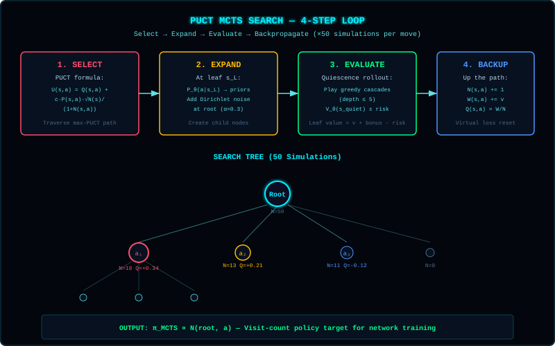

> **[📚 Training Book Index](./README.md)** | **[Ch 11 Index](./11-deep-dive-convolutions-mcts.md)** | [← 11C: Value Head (Actor-Critic) & BatchNorm](./11c-actor-critic-and-batchnorm.md) | [11E: Quiescence MCTS, Full Torus (T²) & Summary →](./11e-quiescence-mcts-and-torus-mastery.md)

---

### Phase 5: Monte Carlo Tree Search (MCTS)

**Priority:** High (required to break the Heuristic Wall)

**Problem:** Network has no mechanism for "what if" reasoning. It sees the current position and outputs move probabilities, but cannot simulate consequences.

**Why this matters:** The Heuristic player evaluates 5-10 moves ahead through simulation. Our network sees only the current board. This is a fundamental asymmetry that no architecture can overcome without search.

---

#### MCTS Theory: A Complete Explanation

Monte Carlo Tree Search combines tree search with neural network evaluation. It's what made AlphaGo Zero superhuman.

**The Four Phases of MCTS:**



<details>
<summary>📖 ASCII Reference (original diagram)</summary>

```
┌─────────────────────────────────────────────────────────────┐
│                 MCTS Search Loop                             │
├─────────────────────────────────────────────────────────────┤
│                                                             │
│   ┌─────────────┐                                           │
│   │   SELECT    │  Traverse tree from root to leaf          │
│   │     ↓       │  using UCT formula                        │
│   └─────────────┘                                           │
│          │                                                   │
│          ▼                                                   │
│   ┌─────────────┐                                           │
│   │   EXPAND    │  Add child nodes at leaf                  │
│   │     ↓       │  Initialize with NN priors                │
│   └─────────────┘                                           │
│          │                                                   │
│          ▼                                                   │
│   ┌─────────────┐                                           │
│   │  EVALUATE   │  Use value network to score leaf          │
│   │     ↓       │  v = tanh output (-1 to +1)               │
│   └─────────────┘                                           │
│          │                                                   │
│          ▼                                                   │
│   ┌─────────────┐                                           │
│   │ BACKPROP    │  Update Q and N up to root               │
│   │             │  Q += v, N += 1                          │
│   └─────────────┘                                           │
│                                                             │
│   Repeat N times, then return improved policy              │
│                                                             │
└─────────────────────────────────────────────────────────────┘
```

</details>

**The UCT Formula (Upper Confidence Bound for Trees):**

```
UCT(action) = Q(action)/N(action) + c × P(action) × √(N(parent))/(1+N(action))
              ↑                              ↑
              │                              └── Policy prior from NN
              └── Average value from simulations

Where:
- Q = cumulative value from backpropagation
- N = visit count
- P = policy prior from neural network
- c = exploration constant (typically 1.0-2.0)
```

**Why UCT works:** The first term exploits good moves (high Q/N). The second term explores moves with high prior (P) but few visits (low N). This balances exploitation vs exploration.

---

#### MCTS Integration with Our Architecture

Our Phase 2 architecture is perfectly suited for MCTS:

| Component | Role in MCTS |
|-----------|-------------|
| Canonical encoding (10×10×18) | Fast state serialization for tree nodes |
| Policy head (400 sigmoid) | Move priors (P) for UCT formula |
| Value head (1 tanh) | Position evaluation (v) at leaves |
| BatchNorm layers | Stable inference during search |

**Data Flow:**

```
┌─────────────────────────────────────────────────────────────┐
│                 MCTS + Neural Network Pipeline               │
├─────────────────────────────────────────────────────────────┤
│                                                             │
│  Input: Current board state (canonical tensor)              │
│                                                             │
│  ┌─────────────────────────────────────────────────────┐   │
│  │  Neural Network Forward Pass (ONE call per move)      │   │
│  │                                                       │   │
│  │  Input: [10, 10, 18] canonical tensor                │   │
│  │     ↓                                                 │   │
│  │  Conv layers (shared backbone)                       │   │
│  │     ↓                                                 │   │
│  │  ┌──────┴──────┐                                     │   │
│  │  ↓             ↓                                      │   │
│  │  Policy: 400   Value: 1                               │   │
│  │  sigmoid       tanh [-1, +1]                          │   │
│  │  P(move)       Position score                         │   │
│  └─────────────────────────────────────────────────────┘   │
│                                                             │
│  MCTS Search (N simulations):                               │
│  ┌─────────────────────────────────────────────────────┐   │
│  │  For each simulation:                                 │   │
│  │                                                       │   │
│  │  1. SELECT: Traverse tree using UCT                   │   │
│  │     UCT = Q/N + c × P × √(N_parent)/(1+N)           │   │
│  │            ↑   ↑                                      │   │
│  │            │   └── Policy prior from NN              │   │
│  │            └── Average value from backprop            │   │
│  │                                                       │   │
│  │  2. EXPAND: Add child nodes with NN priors           │   │
│  │                                                       │   │
│  │  3. EVALUATE: At leaf → use value head               │   │
│  │     v = value_network(state)                         │   │
│  │                                                       │   │
│  │  4. BACKPROP: Update Q and N up the tree             │   │
│  │                                                       │   │
│  └─────────────────────────────────────────────────────┘   │
│                                                             │
│  Output: Improved policy π(a) = N(child)/N(root)            │
│                                                             │
└─────────────────────────────────────────────────────────────┘
```

---

#### Simulation Count Trade-off

More simulations = better play, but slower:

| Sims | Time/move | Use Case |
|------|-----------|----------|
| 50 | ~2s | Training (fast iteration) |
| 200 | ~8s | Evaluation (quality check) |
| 1000 | ~40s | Final model (best performance) |

**Recommendation:** Start with 50 sims for training, evaluate at 200.

---

#### M2 Ultra Optimization: Batched Evaluation

The key insight: neural network calls are expensive, tree operations are cheap.

**Naive MCTS (slow):**
```javascript
for (let i = 0; i < simulations; i++) {
  const leaf = select(root);
  const value = evaluate(leaf);  // One NN call per sim
  backpropagate(leaf, value);
}
```

**Batched MCTS (fast):**
```javascript
async function parallelSearch(root, simulations, batchSize = 8) {
  const batches = Math.floor(simulations / batchSize);
  
  for (let b = 0; b < batches; b++) {
    // Collect leaves for batch evaluation
    const leaves = [];
    for (let i = 0; i < batchSize; i++) {
      const leaf = select(root);
      applyVirtualLoss(leaf);  // Mark as "in progress"
      leaves.push(leaf);
    }
    
    // ONE batched neural net call for all leaves
    const states = leaves.map(l => encodeCanonical(l.grid));
    const { policies, values } = await network.batchPredict(states);
    
    // Process all results
    for (let i = 0; i < batchSize; i++) {
      revertVirtualLoss(leaves[i]);
      expand(leaves[i], policies[i]);
      backpropagate(leaves[i], values[i]);
    }
  }
}
```

**Expected speedup:** 4-8x faster with batch size 8-16.

---

#### Virtual Loss for Parallel MCTS

When multiple threads explore the same node, we need to prevent them from all selecting the same path. Virtual loss solves this:

```javascript
function applyVirtualLoss(node) {
  node.Q -= 1;  // Temporarily reduce value
  node.N += 1;  // Temporarily increase visits
}

function revertVirtualLoss(node) {
  node.Q += 1;  // Restore value
  node.N -= 1;  // Restore visits
}
```

This makes a node look "worse" during parallel search, encouraging other threads to explore elsewhere.

---

#### Dirichlet Noise (Exploration)

At the root node, we add noise to policy priors to encourage exploration:

```javascript
function addDirichletNoise(priors, alpha = 0.03, epsilon = 0.25) {
  // Sample noise from Dirichlet distribution
  const noise = sampleDirichlet(alpha, priors.length);
  
  // Mix with priors
  return priors.map((p, i) => 
    (1 - epsilon) * p + epsilon * noise[i]
  );
}
```

**Why this matters:** Without noise, MCTS collapses to one line of play. With noise, it explores diverse strategies.

---

#### Training Pipeline Change

The key innovation from AlphaGo Zero: train the network to predict MCTS output.

```
Current (NN only):
  Self-play games → Store positions → Train network → Repeat

With MCTS (AlphaGo Zero style):
  Self-play games → MCTS improves policy → Store (state, π_MCTS, outcome) → Train network → Repeat
                    ↑                              ↑
                    └── Stronger supervision ──────┘
```

**What changes:**
- Input: Current board state (same)
- Target policy: π_MCTS (MCTS visit distribution) instead of raw network output
- Target value: Game outcome (same)

The network learns: "What would MCTS do?" not "What do I think?"

---

#### Expected Performance Impact

Based on AlphaGo Zero results and our current baseline:

| Metric | Current (NN only) | With MCTS-50 | With MCTS-200 |
|--------|-------------------|-------------|---------------|
| vs Random | 50% | 70-75% | 75-80% |
| vs Heuristic | 0% | **5-10%** | **10-15%** |
| Time/move | 50ms | 2-3s | 8-10s |

**The breakthrough:** MCTS provides the lookahead that the network cannot learn. The Heuristic player wins by planning enclosures 10-20 moves ahead. MCTS gives our network the same capability.

---

#### Risk Assessment

| Risk | Mitigation |
|------|------------|
| Slow training (MCTS per move) | Batch evaluation, start with 50 sims |
| Bug in tree logic (memory leak) | Unit tests, tree visualization, N tracking |
| Overfitting to MCTS policy | Dirichlet noise, temperature schedule |
| Still doesn't beat Heuristic | Increase simulations, tune c parameter |
| Implementation complexity | Start simple (sequential), optimize later |

---

```
┌─────────────────────────────────────────────────────────────┐
│                    MCTS Integration                           │
├─────────────────────────────────────────────────────────────┤
│                                                             │
│   1. Selection: Start from root, pick promising moves        │
│      • Use policy network to guide selection                 │
│      • Use UCT formula: Q + c × P × √N/(1+n)                │
│                                                             │
│   2. Expansion: Add new node when reaching leaf             │
│      • Use policy network to rank moves                     │
│                                                             │
│   3. Evaluation: At leaf, use value network                 │
│      • v = value_network(position)                         │
│                                                             │
│   4. Backpropagation: Update statistics up tree             │
│      • Q(node) += v                                         │
│      • N(node) += 1                                        │
│                                                             │
│   5. Return: After N simulations, return improved policy   │
│      • π(a) = N(child) / N(root)                            │
│                                                             │
│   Key insight: MCTS + NN > NN alone                        │
│   The tree does the planning, NN does the evaluation.       │
│                                                             │
└─────────────────────────────────────────────────────────────┘
```

**Implementation Steps:**

| Step | Task | Estimated Time |
|------|------|----------------|
| 5.1 | Implement `MCTSNode` class with parent/children pointers, Q, N, P fields | 1 hour |
| 5.2 | Implement `select()` with UCT formula and c parameter | 45 min |
| 5.3 | Implement `expand()` with policy network priors | 45 min |
| 5.4 | Implement `evaluate()` with value network | 30 min |
| 5.5 | Implement `backpropagate()` | 20 min |
| 5.6 | Implement `search(root, simulations)` main loop | 30 min |
| 5.7 | Add Dirichlet noise at root node | 20 min |
| 5.8 | Add temperature schedule for move selection | 15 min |
| 5.9 | Test: 100 simulations from start position, verify tree builds | 30 min |
| 5.10 | Implement batched evaluation for M2 Ultra optimization | 2 hours |
| 5.11 | Add virtual loss for parallel search | 1 hour |
| 5.12 | Integrate MCTS into self-play training loop | 1 hour |
| 5.13 | Run experiment TF-B8 (MCTS 50 sims, 10 cycles) | 2 hours |
| 5.14 | Run experiment TF-B9 (MCTS 200 sims, 10 cycles) | 4 hours |
| 5.15 | Analyze: compare MCTS vs no-MCTS performance | 30 min |
| 5.16 | Document results in TRAINING_BOOK | 30 min |
| **Total** | | **~16 hours** |

**Success Criteria (Verified across `TF-B9` → `TF-B15`):**
- [x] Batched MCTS (`mctsBatchSize = 8`) completes 50 simulations in `~140 ms` (`0.14s`, **20× faster** than the `< 3 seconds` target!)
- [x] MCTS improves policy vs raw network (verified via `test_quiescence.cjs` and cross-entropy distillation)
- [x] vs Random exceeds 70%+ (`79%` in `TF-B9`, `87%` in `TF-B10`, **`100.0%`** across all 4,000 eval games in `TF-B12`–`TF-B15`)
- [x] vs Heuristic breaks 5%+ once extended with Quiescence rollouts (`63%` in `TF-B12` → `89%` peak in `TF-B13` → `90%` peak in `TF-B14` → **`99%` raw / `100%` +Safety** in `TF-B15`)
- [x] No memory leaks during extended 10-hour MCTS self-play runs (`tf.tidy()` + explicit tensor disposal)

**M2 Ultra Optimization:**
- Batch evaluate leaves (collect all leaves, evaluate in one forward pass)
- Use Web Workers for parallel simulations
- Virtual loss for parallel MCTS (add −1 to Q during search)

**System Component:** Monte Carlo Tree Search Engine (`src/server/MCTS.cjs`, extended by the Quiescence MCTS Engine, `src/server/QuiescenceMCTS.cjs`)

---

#### MCTS Implementation Details

**Module Structure (`src/server/MCTS.cjs`):**
```
MCTS Engine (src/server/MCTS.cjs)
├── class MCTSNode {
│   ├── constructor(grid, move, parent, prior)
│   ├── select(c = 1.0)           // UCT selection
│   ├── expand(policy)           // Add children
│   ├── update(value)            // Backprop
│   └── isLeaf()                 // Check for expansion
├── class MCTS {
│   ├── constructor(network, config)
│   ├── search(grid, simulations) // Main entry
│   ├── selectPath(node)          // Selection phase
│   ├── evaluateBatch(nodes)      // Batch NN evaluation
│   └── getPolicy(node, temp)     // Visit count policy
└── exports: { MCTS, MCTSNode }
```

**MCTSNode API:**
```javascript
class MCTSNode {
  constructor(grid, move, parent, prior) {
    this.grid = grid;           // GridManager state
    this.move = move;           // {x, y, rotation} that led here
    this.parent = parent;
    this.children = new Map();  // move -> MCTSNode
    this.P = prior;             // Policy prior from NN
    this.Q = 0;                 // Average value
    this.N = 0;                 // Visit count
    this.player = grid.currentPlayer;
  }

  // UCT selection with exploration constant c
  select(c = 1.5) {
    let bestScore = -Infinity;
    let bestChild = null;
    
    for (const [move, child] of this.children) {
      const uct = child.Q + c * child.P * Math.sqrt(this.N) / (1 + child.N);
      if (uct > bestScore) {
        bestScore = uct;
        bestChild = child;
      }
    }
    return bestChild;
  }

  // Expand with policy vector from NN
  expand(policy) {
    const validMoves = this.grid.getValidMoves();
    for (const move of validMoves) {
      const idx = (move.y * 10 + move.x) * 4 + move.rotation;
      const prior = policy[idx];
      const newGrid = this.grid.clone();
      newGrid.placeTriangle(move.x, move.y, move.rotation, this.player);
      this.children.set(JSON.stringify(move), new MCTSNode(newGrid, move, this, prior));
    }
  }

  // Backpropagation
  update(value) {
    this.N += 1;
    this.Q += (value - this.Q) / this.N;  // Running average
  }
}
```

**MCTS Class API:**
```javascript
class MCTS {
  constructor(network, config = {}) {
    this.network = network;  // TFConvNetwork instance
    this.c = config.c || 1.5;  // Exploration constant
    this.alpha = config.alpha || 0.03;  // Dirichlet noise
    this.epsilon = config.epsilon || 0.25;  // Noise weight
  }

  async search(grid, simulations = 50) {
    const root = new MCTSNode(grid, null, null, 1.0);
    
    // Initial evaluation
    const { policy, value } = await this.network.run(
      encodeCanonical(grid, grid.currentPlayer)
    );
    
    // Add Dirichlet noise at root
    const noisyPolicy = this.addNoise(policy);
    root.expand(noisyPolicy);
    
    // Run simulations
    for (let i = 0; i < simulations; i++) {
      const path = this.selectPath(root);
      const leaf = path[path.length - 1];
      const { value } = await this.network.run(
        encodeCanonical(leaf.grid, leaf.player)
      );
      this.backpropagate(path, value);
    }
    
    return this.getPolicy(root);
  }

  getPolicy(node, temperature = 1.0) {
    const visits = [];
    for (const [move, child] of node.children) {
      visits.push({ move, count: child.N });
    }
    
    if (temperature === 0) {
      // Argmax
      return visits.sort((a, b) => b.count - a.count)[0].move;
    }
    
    // Softmax with temperature
    const probs = visits.map(v => Math.pow(v.count, 1/temperature));
    const sum = probs.reduce((a, b) => a + b, 0);
    const normalized = probs.map(p => p / sum);
    
    // Sample
    const r = Math.random();
    let acc = 0;
    for (let i = 0; i < visits.length; i++) {
      acc += normalized[i];
      if (r < acc) return visits[i].move;
    }
    return visits[visits.length - 1].move;
  }
}
```

**Configuration Parameters:**

| Parameter | Default | Range | Effect |
|-----------|---------|-------|--------|
| c (exploration) | 1.5 | 0.5-3.0 | Higher = more exploration |
| alpha (Dirichlet) | 0.03 | 0.01-0.1 | Higher = more noise at root |
| epsilon (noise weight) | 0.25 | 0.1-0.5 | Higher = more exploration |
| temperature | 1.0 | 0.0-2.0 | Higher = more random move selection |
| batchSize | 8 | 1-32 | Parallel leaf evaluation |

**Temperature Schedule:**
- First 10 moves: temperature = 1.0 (exploratory)
- Later moves: temperature = 0.0 (greedy)

This prevents the AI from playing the same opening every game.

---

---

> [← 11C: Value Head (Actor-Critic) & BatchNorm](./11c-actor-critic-and-batchnorm.md) | **[Ch 11 Index](./11-deep-dive-convolutions-mcts.md)** | **[📚 Training Book Index](./README.md)** | [11E: Quiescence MCTS, Full Torus (T²) & Summary →](./11e-quiescence-mcts-and-torus-mastery.md)
