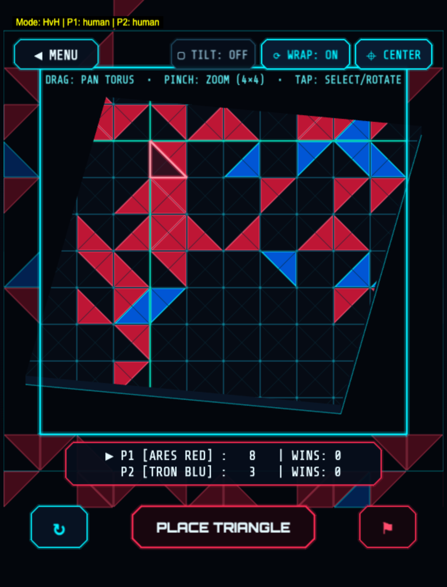

> **[📚 Training Book Index](./README.md)** | [← 11E: Quiescence MCTS & Full Torus (T²)](./11e-quiescence-mcts-and-torus-mastery.md) | [Appendices A, B & C →](./appendices.md)

---

## 12. Toroidal 3D Visualization, Dual-View Projection & Human Telemetry {#12-toroidal-visualization}




To make the $T^2$ topology intuitive for human players while preserving the mathematical integrity of the core engine and AI tensor pipeline, Triantica enforces a strict **Engine-View Separation Architecture**:

<details>
<summary>📐 Diagram: STRICT ENGINE / VIEW-PROJECTION SEPARATION (click to expand ASCII)</summary>

```
┌──────────────────────────────────────────────────────────────────────────────┐
│                 STRICT ENGINE / VIEW-PROJECTION SEPARATION                   │
├──────────────────────────────────────────────────────────────────────────────┤
│                                                                              │
│   CORE ENGINE & AI LAYER (`GridManager.js`, `ConvNetwork.cjs`, `MCTS.cjs`)   │
│   ────────────────────────────────────────────────────────────────────────   │
│   • Canonical discrete `[10 × 10]` cell coordinates (`x, y ∈ {0..9}`)        │
│   • Planar-Corner Baseline (`TF-B14`): Planar corners + Toroidal flood-fill  │
│   • Full Torus (`TF-B15`): Full $T^2$ modulo vertex & edge adjacency (100    │
│     unique vertices, each shared by 12 triangles) + `ToroidalPad2D`          │
│   • Zero dependency on camera angles, 3D meshes, or Phaser rendering         │
│                                                                              │
│                                      │                                       │
│                         Pure State Projection $(u, v)$                       │
│                                      ▼                                       │
│   VIEW-PROJECTION LAYER (`ToroidalViewport.js`, `Torus3DView.js`)            │
│   ───────────────────────────────────────────────────────────────            │
│   • 2D Toroidal Panning (`Shift+Drag` / Right-Drag / Arrow Keys):            │
│     Shifts visual origin `(offsetX, offsetY)` modulo 10 so any wrap-around   │
│     cluster can be centered seamlessly on the flat screen.                   │
│   • Synchronized 3D Torus Surface (`Torus3DView.js`):                        │
│     Maps normalized grid coordinates $(u, v) = (x/10, y/10) \in [0, 1)^2$    │
│     onto the parametric 3D ring torus ($R = 2.5, r = 1.0$):                  │
│       $X(\theta, \phi) = (R + r \cos\phi)\cos\theta$                         │
│       $Y(\theta, \phi) = (R + r \cos\phi)\sin\theta$                         │
│       $Z(\theta, \phi) = r \sin\phi$                                         │
│     where $\theta = 2\pi u$ (major ring) and $\phi = 2\pi v$ (minor tube).   │
│                                                                              │
└──────────────────────────────────────────────────────────────────────────────┘
```

</details>

### Dual-View Projection Mechanics: How 2D Panning and the 3D Parametric Ring Torus Synchronize

1. **Translation-Invariant 2D Toroidal Panning (`src/core/ToroidalViewport.js`):**
   On a traditional flat board, pieces near $(x=0, y=0)$ and $(x=9, y=9)$ sit at opposite corners of the screen, making it difficult for human players to spot wrap-around enclosures. The 2D Toroidal Viewport decouples logical board coordinates $(x, y) \in \{0\dots 9\}^2$ from screen coordinates $(s_x, s_y)$ via an interactive viewport offset $(\Delta_x, \Delta_y)$:
   $$s_x = (x + \Delta_x) \bmod 10, \qquad s_y = (y + \Delta_y) \bmod 10$$
   Holding `Shift+Drag`, right-dragging, or pressing the arrow keys shifts $(\Delta_x, \Delta_y)$ smoothly in real time, allowing a player to center any cross-seam battle directly in the middle of the 2.5D viewport without mutating a single coordinate in `GridManager.js`.
2. **Parametric 3D Ring Torus Embedding (`src/core/Torus3DView.js`):**
   Alongside the 2.5D grid, the synchronized 3D Torus View maps normalized board coordinates $(u, v) = (x/10, y/10) \in [0, 1)^2$ onto a continuous 3D ring torus with major radius $R = 2.5$ and minor tube radius $r = 1.0$:
   $$X(\theta, \phi) = (R + r\cos\phi)\cos\theta, \quad Y(\theta, \phi) = (R + r\cos\phi)\sin\theta, \quad Z(\theta, \phi) = r\sin\phi$$
   where $\theta = 2\pi u$ sweeps around the major ring and $\phi = 2\pi v$ sweeps around the minor tube cross-section. Hovering or placing a triangle in either view highlights the exact corresponding manifold face in both projections simultaneously.

### Continuous Learning from Human Play (Human Match Telemetry Logger, `HumanGameLogger.js`)
With `TF-B15` deployed to production (`trainedAI_network.json`) across **Easy** (high-temperature exploration sampling), **Medium** (`99.0%` Raw 1-ply ConvNet), and **Hard** (`100.0%` ConvNet + Top-12 Tactical Safety Filter), the browser and server runtimes include a **human match telemetry logger** (`src/data/HumanGameLogger.js`, persisted via `/api/human-games`).

Every completed human match records canonical `10×10×18` ego-centric states, chosen action indices (`0..399`), immediate enclosure claims, and final cluster outcomes. Because human trajectories use the exact same canonical format as self-play MCTS trajectories, they can be injected directly into the `ReplayBuffer` (`src/server/ReplayBuffer.cjs`)—enabling continuous human-in-the-loop reinforcement learning without altering the core training pipeline.

---

> [← 11E: Quiescence MCTS & Full Torus (T²)](./11e-quiescence-mcts-and-torus-mastery.md) | **[📚 Training Book Index](./README.md)** | [Appendices A, B & C →](./appendices.md)
